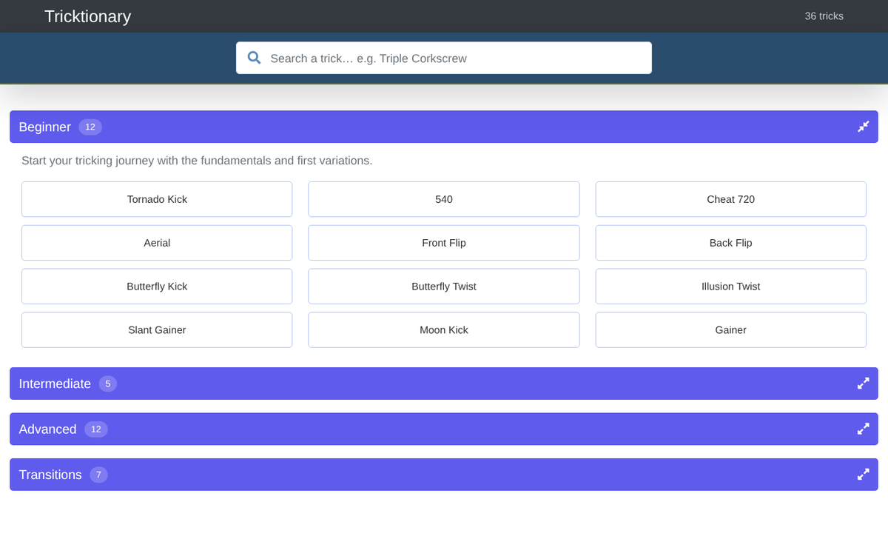
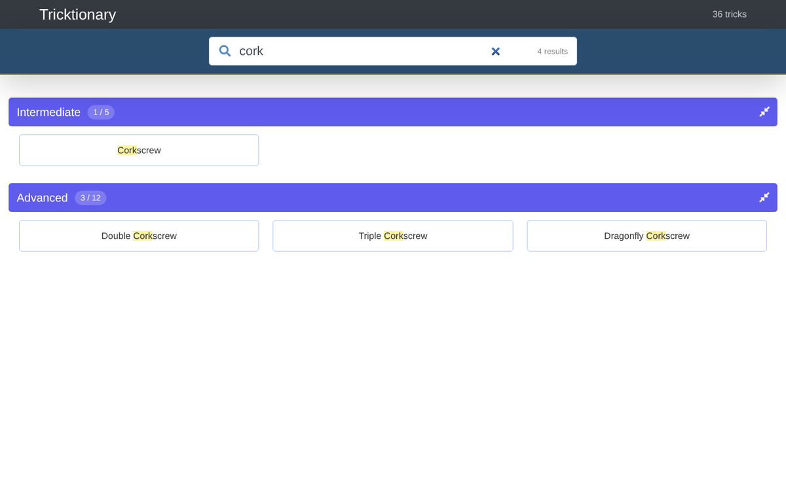
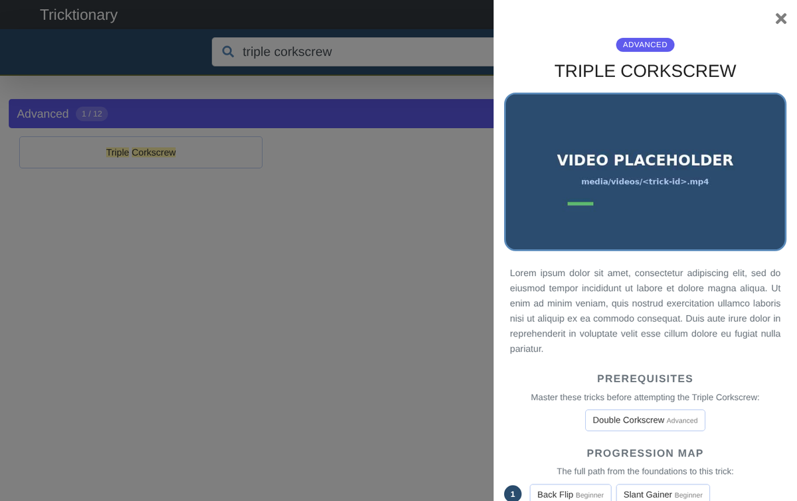
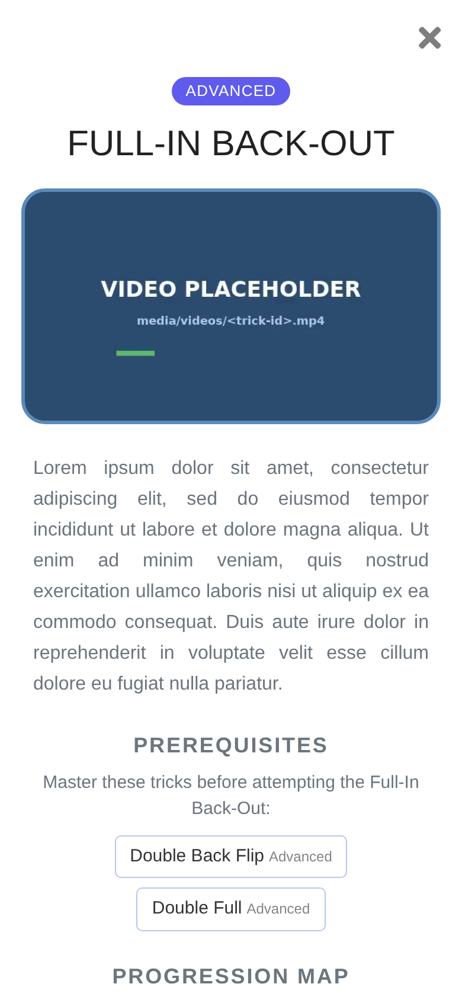

# Tricktionary

Glossário pesquisável de movimentos de **tricking**: 36 tricks organizados em 4 níveis, cada um com vídeo, descrição, pré-requisitos e um **mapa de progressão** que mostra o caminho desde os tricks base até ele.

Inspirado no Tricktionary do Club540 (entretanto desativado). Esta versão foi reescrita de raiz: a página é gerada a partir de um ficheiro JSON e acrescenta pesquisa em todos os níveis e o mapa de progressão.



| Pesquisa em todos os níveis | Detalhe e mapa de progressão |
|---|---|
|  |  |

> As descrições (lorem ipsum) e o vídeo são **placeholders**. Os nomes dos tricks são os que estavam no club540.
> A lista é propositadamente curta: uma seleção de tricks conhecidos para mostrar o funcionamento. Para acrescentar mais, basta editar o JSON (ver abaixo).

## Funcionalidades

- **4 níveis** em acordeão:

  | Nível | Tricks | Exemplos |
  |---|---:|---|
  | Beginner | 12 | Tornado Kick, 540, Aerial, Back Flip, Butterfly Kick |
  | Intermediate | 5 | Cheat 900, Full, Corkscrew, Boxcutter |
  | Advanced | 12 | Cheat 1080, Double Full, Full-In Back-Out, Triple Corkscrew |
  | Transitions | 7 | Cartwheel, Hook Kick, J-Step, Scoot, Master Scoot |

- **Pesquisa** em todos os níveis ao mesmo tempo. Ignora maiúsculas, acentos, hífenes e espaços ("full in" encontra "Full-In Back-Out"), destaca o texto encontrado e mostra quantos resultados há em cada nível. A tecla Esc limpa a pesquisa.
- **Detalhe do trick** num painel lateral: vídeo em loop, descrição, **pré-requisitos** e **o que desbloqueia**. Carregar num trick relacionado navega para ele.
- **Mapa de progressão:** todos os antecessores de um trick, organizados por passos, desde os tricks base até ele. Por exemplo, o Triple Corkscrew: Back Flip + Slant Gainer → Gainer → Corkscrew → Double Corkscrew → Triple Corkscrew.
- **Link direto para um trick**, por exemplo `index.html#trick/triple-corkscrew`.
- Funciona em telemóvel e offline: as bibliotecas estão em `vendor/`, sem dependências de CDN.

<p align="center"></p>

## Estrutura

```
index.html              ← só a "moldura" da página
css/style.css           ← o visual
js/app.js               ← gera os níveis, os botões, a pesquisa, o detalhe e o mapa
data/tricks.json        ← todos os níveis e tricks (a única coisa a editar para mudar conteúdo)
media/videos/           ← vídeos dos tricks (ver o README dessa pasta)
vendor/                 ← jQuery, Bootstrap 4 e Font Awesome (com as respetivas licenças)
docs/img/               ← screenshots
```

### Formato do `data/tricks.json`

```json
{
  "_info": "Nota livre sobre os dados (ignorada pela página)",
  "levels": [
    { "id": "advanced", "name": "Advanced", "description": "..." }
  ],
  "tricks": [
    {
      "id": "triple-corkscrew",
      "name": "Triple Corkscrew",
      "level": "advanced",
      "description": "...",
      "video": "media/videos/placeholder.mp4",
      "prerequisites": ["double-corkscrew"]
    }
  ]
}
```

- `level` é o `id` de um dos `levels`. A ordem dos níveis no JSON é a ordem na página, e o mesmo vale para os tricks dentro de cada nível.
- Para criar, juntar ou renomear níveis basta editar a lista `levels` e o campo `level` dos tricks. O `js/app.js` não precisa de mudanças.
- `prerequisites` é uma lista de `id`s de outros tricks. O "desbloqueia" e o mapa de progressão são calculados a partir daqui. Um `id` que não exista é ignorado.
- Os pré-requisitos atuais são **sugestões** (por exemplo, Double Corkscrew → Corkscrew). Rever depois.

## Como executar

A página lê o JSON com `fetch`, por isso tem de ser servida por HTTP. Abrir o `index.html` com duplo clique não funciona.

```bash
python -m http.server 8000
# abrir http://localhost:8000
```

Ou numa pasta do XAMPP (`htdocs`).

---

Desenvolvido por **Joel Monteiro** com base na antiga página Tricktionary do club540.
